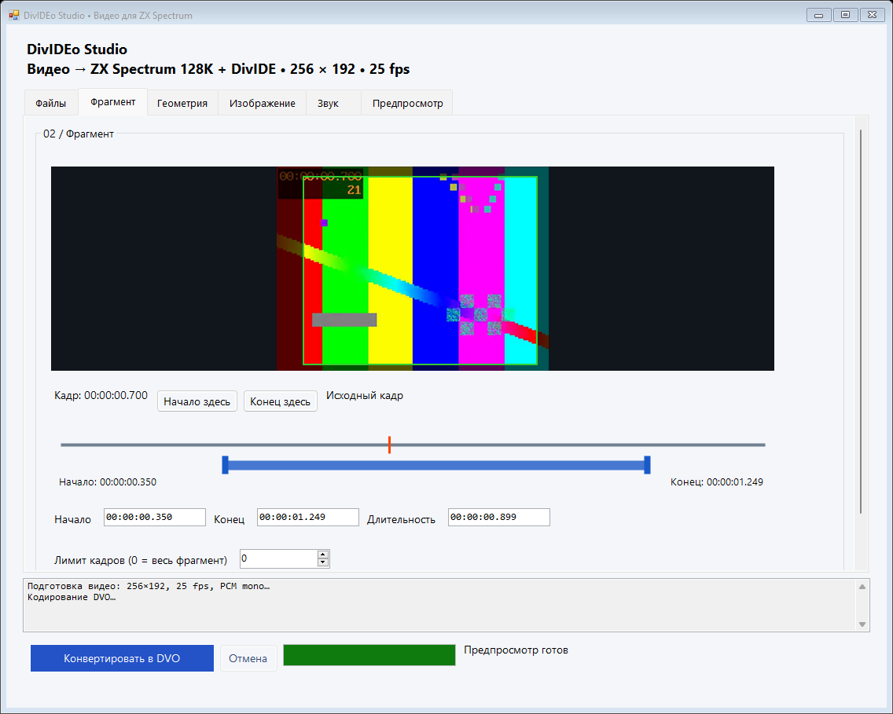
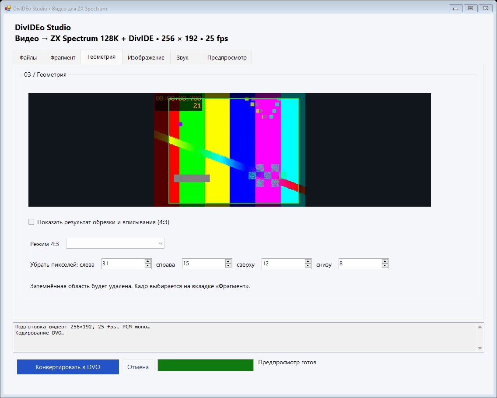
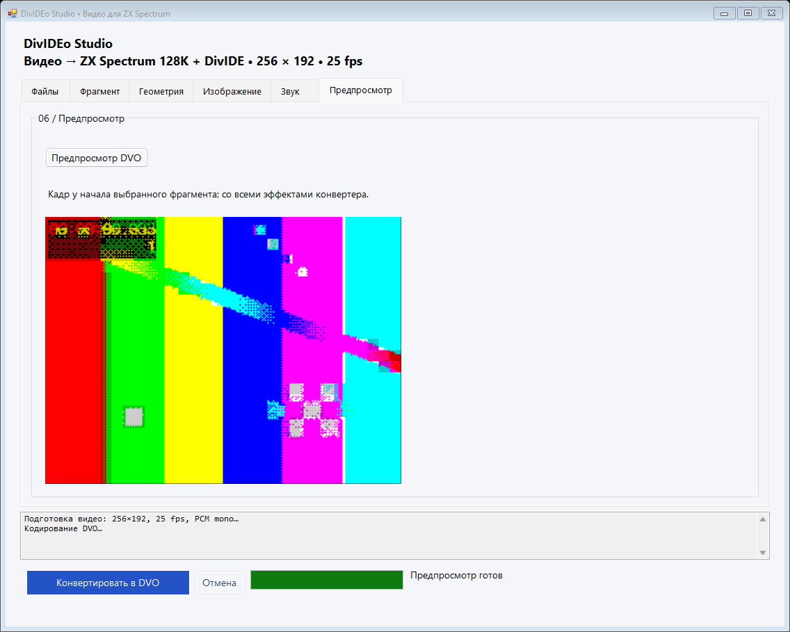
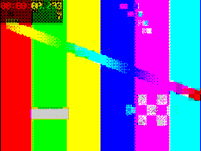

# DivIDEo Studio

[](https://github.com/dejanoff/divideo-studio/releases/latest)
[](LICENSE)
[](#requirements)
[](#requirements)

**DivIDEo Studio** is an all-in-one desktop video converter GUI designed to produce ready-to-play `.dvo` video streams for the **ZX Spectrum 128K** retro computer equipped with a **DivIDE** ATA/IDE storage interface.

It automates the entire video preparation pipeline — trimming, aspect ratio fitting, pixel cropping, audio mixing, dithering, and formatting — into a single portable application.

*(Документация на русском языке доступна в файле [ИНСТРУКЦИЯ.md](ИНСТРУКЦИЯ.md))*

---

## Screenshots

| Timeline & Fragment Selection | Interactive Crop & 4:3 Fitting |
| :---: | :---: |
|  |  |

| Spectrum VRAM Preview (Dithering & Clash) | ZX Spectrum Screen Output |
| :---: | :---: |
|  |  |

---

## Features

- **Portable & All-in-One**: No complex setup required. The standalone executable bundles `FFmpeg 7.0.2`, `FFprobe`, and the original `divideo` encoder as internal resources, extracting them on demand.
- **Interactive Dual-Track Timeline**:
  - Upper track controls the frame seek cursor (step by 0.04s / 1 frame with $\leftarrow$ / $\rightarrow$ keys).
  - Lower track with dual handles for setting start and end boundaries.
  - Precise timecode entry (`hh:mm:ss.fff` or `mm:ss`).
- **Visual Crop & 4:3 Geometry**:
  - Pixel-precise margin cropping with real-time darkened overlay.
  - Three 4:3 framing modes for the ZX Spectrum: **Letterbox** (with black bars), **Fill** (crop to 4:3), or **Stretch**.
- **Accurate Spectrum Video Synthesis**:
  - Full Colour or Monochrome rendering.
  - Bayer ordered dithering ($4\times4$, $2\times2$, or none).
  - Adjustable contrast and brightness curves.
  - Custom Spectrum border color selection ($0\text{--}7$).
  - Optional subtitle overlay supporting Latin and Cyrillic Unicode text.
  - Up to 32-character ASCII title tag for the Spectrum loader menu.
- **Audio Pipeline**:
  - Multi-track audio detection and stream selector.
  - Automatic downmixing and conversion to 44.1 kHz mono PCM.
  - Volume scaling or silence generation for silent clips.
- **Software ZX Spectrum VRAM Decoder**:
  - Built-in preview simulates the real ZX Spectrum 128K video memory ($256\times192$ screen + $32\times24$ color attribute grid) to inspect dithering and color clash before conversion.
- **DVO Container Integrity**:
  - Automatic 512-byte sector padding for IDE streaming.
  - Container header, packet structure, and end-of-frame marker verification.
  - Safe atomic file saving with cancelable operations.

---

## Requirements

### Host PC (for conversion)
- **OS**: Windows 7, 8, 10, or 11 (64-bit).
- **Runtime**: .NET Framework 4.5 or newer (pre-installed on Windows 10 and 11).
- **Disk Space**: At least 500 MB free on `%TEMP%` (~225 MB temporary uncompressed video per minute of selected clip).

### Target Hardware (for playback)
- **Computer**: Sinclair ZX Spectrum 128K (+2, +2A, +3 or clones with 128K RAM).
- **Interface**: **DivIDE** interface with IDE/CF card storage.
- **Player**: The DivIDEo player (`divideo.tap` or ROM).
- *Note*: **DivMMC** interfaces are not supported due to the player relying on direct DivIDE IDE ports.
- *Note*: The generated `.dvo` file must be copied to a FAT filesystem **without fragmentation**.

---

## Installation

### Downloading Pre-built Binary
1. Download the latest `DivideoStudio.exe` or `DivideoStudio-v*.zip` from [GitHub Releases](https://github.com/dejanoff/divideo-studio/releases).
2. Place `DivideoStudio.exe` in any convenient directory.
3. No installation or third-party codecs required.

---

## Quick Start

1. **Launch**: Double-click `DivideoStudio.exe`.
2. **Open Video**: Drag & drop any video file (MP4, MKV, AVI, WebM, MOV, etc.) into the window or click **Открыть…**.
3. **Select Fragment**:
   - On tab **02 / Фрагмент**, drag the blue handles on the lower timeline or click **Начало здесь** / **Конец здесь**.
4. **Tune Geometry & Image**:
   - On tab **03 / Геометрия**, adjust crop margins if needed.
   - On tab **04 / Изображение**, select Colour/Mono and dithering.
5. **Preview**:
   - On tab **06 / Предпросмотр**, click **Предпросмотр DVO** to view the rendered ZX Spectrum frame.
6. **Convert**:
   - Click **Конвертировать в DVO**. The resulting `.dvo` file will be generated next to your source video.

---

## Configuration & Options

| Tab | Setting | Default | Description |
| :--- | :--- | :--- | :--- |
| **01 / Файлы** | Источник / Результат | Source path | Input video and destination `.dvo` file path. |
| **02 / Фрагмент** | Начало / Конец / Длит. | Whole video | Precise time interval for encoding. |
| | Лимит кадров | `0` (unlimited) | Optional limit on the number of frames ($25\text{ fps}$). |
| **03 / Геометрия** | Режим 4:3 | Вписать | Fitting mode: *Letterbox (Вписать)*, *Crop to fill (Заполнить)*, *Stretch (Растянуть)*. |
| | Обрезка (L/R/T/B) | `0` | Margins in source pixels to crop out before scaling. |
| **04 / Изображение**| Режим цвета | Цветное | Colour or Black & White. |
| | Дизеринг | $4\times4$ | Ordered Bayer dithering matrix ($4\times4$, $2\times2$, or Off). |
| | Бордюр | 0 (Чёрный) | ZX Spectrum border color ($0\text{--}7$). |
| | Контраст / Яркость | `5.5` / `0.3` | Contrast multiplier and black-level offset. |
| | Название DVO | Base name | Title displayed in the Spectrum player menu (max 32 ASCII chars). |
| | Титр | *(empty)* | Optional subtitle burned into bottom of frame (supports Cyrillic). |
| **05 / Звук** | Аудиодорожка | Track 1 | Source audio stream to downmix to 44.1 kHz mono PCM. |
| | Без звука / Громкость | Off / `1.0` | Option to encode silent audio or amplify volume. |

---

## Project Structure

```
divideo-studio/
├── src/
│   ├── DivideoGui.cs       # Application entry point, Engine pipeline, MainForm, SelfTest
│   └── EditorControls.cs   # Custom WinForms controls (TimeBox, Timeline, CropView)
├── tests/
│   ├── run-tests.ps1       # Automated self-test runner script
│   └── README.md           # Test suite documentation
├── docs/
│   └── images/             # UI screenshots and visual assets
├── build.ps1               # Automated PowerShell build script using csc.exe
├── divideo.exe             # Original 2010 DivIDEo encoder CLI (embedded as resource)
├── ИНСТРУКЦИЯ.md           # Comprehensive Russian user manual
├── README.md               # Project documentation (this file)
├── CHANGELOG.md            # Version history and release notes
├── CONTRIBUTING.md         # Contribution guidelines
├── LICENSE                 # GNU General Public License v3.0
└── .github/
    └── workflows/          # GitHub Actions CI and Release pipelines
```

---

## Building from Source

### Prerequisites
- Windows 10 or 11 x64
- .NET Framework 4.5+ Developer Pack (or `csc.exe` in `%SystemRoot%\Microsoft.NET\Framework64\v4.0.30319`)
- FFmpeg and FFprobe binaries (e.g. via `choco install ffmpeg` or `winget install Gyan.FFmpeg`)
- PowerShell

### Build Command
Clone the repository and run:

```powershell
powershell -ExecutionPolicy Bypass -File .\build.ps1
```

If your FFmpeg tools are in a custom directory, pass `-FfmpegBin`:

```powershell
powershell -ExecutionPolicy Bypass -File .\build.ps1 -FfmpegBin "C:\CustomPath\ffmpeg\bin"
```

The script compiles the C# source files, embeds `ffmpeg.exe`, `ffprobe.exe`, and `divideo.exe` as assembly resources, and creates `DivideoStudio.exe`.

### Running Tests
To run the automated regression test suite:

```powershell
powershell -ExecutionPolicy Bypass -File .\tests\run-tests.ps1
```

---

## Troubleshooting

- **Disk Space Warning**:
  The intermediate rendering uses uncompressed raw video (`bgr24` at $256\times192$, $25\text{ fps}$) which takes ~225 MB per minute in `%TEMP%`. If encoding fails midway, ensure drive C: has sufficient free disk space.
- **Input Frame Rate**:
  The application automatically resamples input video to exactly $25\text{ fps}$ via FFmpeg filters.
- **DivIDE Playback Issues**:
  - The DivIDEo player streams directly from IDE sectors. Ensure the file on your CF card is contiguous (**not fragmented**). Tools like `contig` or formatting the card can help.
  - DivMMC interfaces are not supported by the player software.

---

## Contributing

Contributions, bug reports, and pull requests are welcome! Please check out [CONTRIBUTING.md](CONTRIBUTING.md) for details on code style and testing procedures.

---

## License & Credits

- **DivIDEo Studio GUI & Engine**: Licensed under the [GNU General Public License v3.0](LICENSE).
- **Original DivIDEo Encoder (`divideo.exe`)**: Created by **Matt "Gasman" Westcott** (GPLv2 or later) — [GitHub repository](https://github.com/gasman/divideo) | [Project website](http://divideo.zxdemo.org/).
- **FFmpeg / FFprobe**: Licensed under GPLv3 (Gyan essentials build) — [FFmpeg website](https://ffmpeg.org/).
